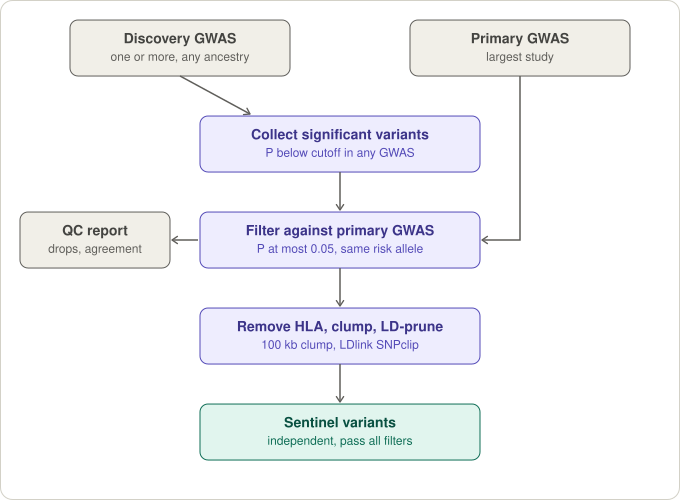
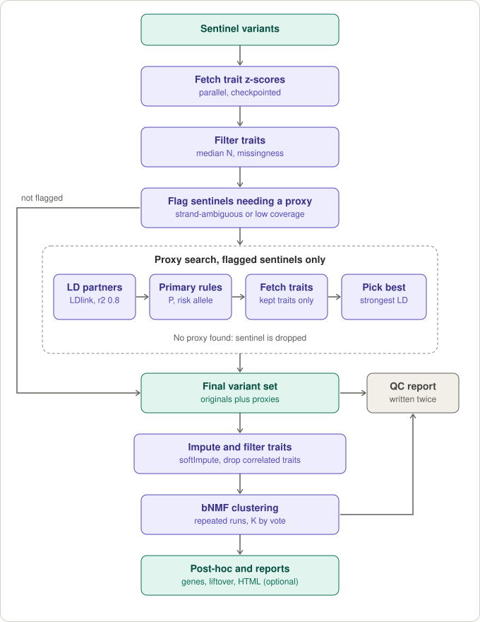

## T2D Multi-ancestry Partitioned Polygenic Scores
Cluster weights are available from the [Smith, Deutsch et al Nature Medicine 2024](https://www.nature.com/articles/s41591-024-02865-3) paper in the "Smith_Deutsch_NatureMedicine_2024" folder. Partitioned polygenic scores (pPS) can be generated using the enclosed variant cluster weights. We have included weights for ancestry-specific and multi-ancestry clusters:

* In the weights files, the "Risk_Allele" column denotes the T2D risk-increasing allele.
* When generating the pPS, all genotypes should be aligned to this allele!
* Weights have been provided in hg38, however a liftover map (hg19 to hg38) is included in each subfolder.

---

## Pipeline for GWAS clustering using Bayesian non-negative matrix factorization (bNMF)

The bNMF procedure, as applied here, detects clusters of GWAS variants for some outcome of interest based on the associations of those variants with a set of additional traits. The pipeline covers variant selection and QC, proxy variant search, z-score matrix preparation, clustering, and post-hoc summarization.

**Genome build:** hg19/GRCh37 for primary analysis; hg38 conversion is handled in the post-hoc step via liftover.

### Pipeline overview

Variants are selected first, then characterized with the additional traits and clustered.





### Quick start

1. Run `Rscript scripts/main_script_example.R` from the repository checkout. It
   uses the supplied toy summary statistics and does not require an LDlink token.
   Results are written to `toy_bnmf_example_results/`; open `QC_report.html`
   there first. On the toy data the report raises two items, both expected: one
   discovery file has no effect-allele column, and many variants are "not in the
   primary GWAS" because each toy file is a small random sample.
2. To adapt the example for a project, copy the driver and manifest, replace the
   input paths, and review the thresholds in the configuration section.
3. Choose a pruning strategy if needed. The example supports LD-based pruning
   through LDlink SNPclip after setting the `LDLINK_TOKEN` environment variable;
   `snp_clump()` is also available for deliberate position-based clumping. These
   are distinct approaches, and the self-contained toy run applies neither by
   default. Proxy replacement needs the same token and nothing else.

The public example ends after `summarize_bNMF()`. Project-specific annotation,
reporting, and post-hoc analysis should be added in a separate project driver.

Sample input files are provided in `example_data/` to illustrate the expected formats: the manifest workbook, three discovery GWAS in two layouts, and the trait files. `example_data/rsID_map_example.txt` shows the two-column `VAR_ID`, `rsID` map that `scripts/format_gwas_input.R` can optionally use; the pipeline itself does not read it.

### Requirements

**System:** a Unix-like shell with `gzip`, `grep` and `awk` (Linux or macOS). The trait fetch reads files in parallel with forked processes; on Windows it falls back to one at a time.

**R packages:**
* Core pipeline and the example: `data.table`, `tidyverse` (including `dplyr`, `tidyr`, `readr`, `stringr`), `magrittr`, `readxl`, `LDlinkR`, `future`, `future.apply`, `furrr`, `parallelly`, `softImpute`, and `R.utils` (lets `data.table` read `.gz` files).
* Optimized bNMF runner: `progressr`, `progress`.
* Post-hoc analysis: `GenomicRanges`, `IRanges`, `rtracklayer`, `openxlsx`, `Homo.sapiens`, `vroom`, `scales`.
* Stability analysis: `ggplot2`, `pheatmap`, `clue`.
* Tests: `testthat`.
* Optional helpers: `curl` (rsID map generator); `S4Vectors` (liftover in the formatter); `strex` (one legacy function).

**LDlink API token:** Several steps use the [LDlinkR](https://cran.r-project.org/package=LDlinkR) package for LD-based operations. Request a free token at https://ldlink.nih.gov/?tab=apiaccess and store it as the environment variable `LDLINK_TOKEN`.

**rsID map (optional):** The proxy search no longer needs one. `scripts/format_gwas_input.R` can use a per-chromosome file mapping `VAR_ID → rsID` to align raw files to reference alleles, and the legacy `choose_proxies()` still reads one. Generate it from 1000 Genomes Phase 3 using `scripts/generate_varid_to_rsid_map_file.R`, which downloads per-chromosome VCFs from Ensembl and writes one map file per chromosome to a local directory. Give that directory to the formatter as `RSID_MAP_DIR`.

### Input data format

**Build and variant type.** Positions must be hg19/GRCh37. Only biallelic autosomal SNPs with A/C/G/T alleles are used. Indels, multiallelic IDs and chromosomes X, Y and MT are dropped as each file is read, and the number dropped is reported.

**Locating variants.** Each summary statistics file needs one of:
* `VAR_ID` in `CHR_POS_REF_ALT` form (e.g. `1_123456_A_G`), or
* `CHR` and `POS` columns, or
* `SNP` in `chr:pos` form (e.g. `1:123456`).

**Alleles.** Files do **not** need to share one REF/ALT order. The pipeline tracks each file's effect allele explicitly and matches variants across files on position plus allele pair, so `1_123456_A_G` in one file and `1_123456_G_A` in another are the same variant. Output files use the primary GWAS's allele order.

The effect allele of a file is decided as follows, and the same rule applies to discovery and trait files:
1. the optional `effect_allele` column of the manifest row, if filled in: `ALT`, `REF`, or the name of a column in the file;
2. otherwise the first of these columns present in the file: `EA`, `Effect_Allele`, `Effect_Allele_PH`, `effect_allele`, `A1`;
3. otherwise **ALT is assumed**, i.e. the second allele of `VAR_ID`.

The other allele is taken from `VAR_ID` (or `REF`/`ALT` columns) when present, otherwise from `NEA`, `Other_Allele`, `other_allele`, `Non_Effect_Allele` or `A2`.

The rule used for every file is printed and written to `input_qc_discovery_gwas.txt` and `input_qc_trait_gwas.txt`. **Check it.** A wrong genome build or strand shows up as unmatched variants, but a wrong effect allele in a trait file shows up as nothing except flipped z-scores. For discovery files the pipeline reports each file's risk-allele agreement with the primary GWAS and warns when it is low.

**Strand.** A trait file reported on the opposite strand is matched by complementing its alleles, for non-palindromic variants. Palindromic variants (A/T, C/G) cannot be resolved this way and are used as reported; palindromic sentinels are sent to the proxy search. Discovery files are matched to the primary GWAS on the allele pair as written, so a discovery file on the opposite strand shows up as many variants "not in the primary GWAS".

**Statistics columns.**
* Discovery and primary GWAS: `P_VALUE`, and `BETA` or `ODDS_RATIO`. `SE` is optional for the primary GWAS (it is derived from `BETA` and `P_VALUE` when absent). Use `rename_cols` to map differently named columns.
* Trait GWAS: `BETA` and `SE` are required. `P_VALUE` is optional.
* Sample size: an `N_PH` or `N` column is optional. A `sample_size` filled in on the manifest takes precedence over the file's column.

**Formatting helper.** `scripts/format_gwas_input.R` converts raw downloaded summary statistics (auto-detected columns, optional hg38→hg19 liftover, optional alignment to the 1000 Genomes REF/ALT) into a layout the pipeline reads. It is a convenience, not a requirement.

**GWAS manifest (Excel):** The pipeline is configured via a two-sheet Excel workbook:
* **`main_gwas` sheet** — one row per GWAS study for the primary trait being clustered. Required columns: `study`, `trait`, `population` (used together to build a per-study ID and to group studies for multi-ancestry LD pruning), `full_path` (path to summary stats file), `largest` (`Yes` for the study used to define the variant set; `No` otherwise). Optional: `effect_allele` (see above).
* **`trait_gwas` sheet** — one row per additional trait used to characterize clusters. Required columns: `trait`, `full_path`, `sample_size`. Optional: `effect_allele`. Z-scores for each variant are computed from each trait's summary stats.

Only `full_path` is read for the file location. The `root_path` and `file` helper columns in the example are optional bookkeeping — in the example workbook `full_path` is simply their concatenation, written out as a plain string so it can be read without Excel recalculating any formulas.

See `example_data/clustering_data_source_example.xlsx` for a working example of this format.

### How variants are selected

Two P-values are carried for every variant, in separately named columns. There is deliberately no bare `PVALUE` column.

| Column | Meaning | Used for |
|---|---|---|
| `PVALUE_discovery` | Lowest P across the discovery GWAS (`main_gwas` sheet) | Whether a variant is eligible to be a sentinel |
| `PVALUE_main` | P in the primary GWAS (`largest = Yes`) | Whether a variant stays in, and which variant leads a locus |

1. **Discovery variants.** `get_sig_snps()` collects every variant with P ≤ `PVCUTOFF` in any discovery GWAS.
2. **Primary-GWAS filters.** `get_biggest_gwas()` keeps a variant only if it is present in the primary GWAS, has a direction of effect in both GWAS (effect not missing or zero), has `PVALUE_main` ≤ `MAIN_PVCUTOFF` (default 0.05), and has the **same risk allele** in the discovery and primary GWAS. These filters run before any clumping or pruning, so a locus whose top variant fails can fall back to its next-best variant. Every removed variant is written to `variants_removed_by_primary_gwas.txt` with one reason.
3. **Sentinel candidates.** The variants that passed step 2, outside the HLA region.
4. **Clumping / LD pruning.** `snp_clump()` and `ld_pruning_SNP.clip()` keep the first variant of each locus under `order_by`, which has no default. The example uses `c("PVALUE_main", "PVALUE_discovery")`: the strongest variant in the primary GWAS leads, with the discovery P as tiebreaker.
5. **Trait fetch.** `fetch_summary_stats()` returns a z-score row for every sentinel. A sentinel no trait file contains is a row of `NA`, never a missing row. This is usually the slowest step: every trait file is decompressed and scanned in full, so its time depends on the number and size of trait files, not on how many variants are requested. Set `n_workers` to read several trait files at once (results are identical for any value), and keep `checkpoint_dir` set so a rerun reuses what was already read.
6. **Proxies.** A sentinel that is strand-ambiguous (A/T or C/G) or has data for too few traits is replaced by a variant in strong LD with it, or dropped. It is never kept as itself. Three functions do this in turn:
   * `find_proxy_candidates()` asks LDlink for the LD partners of the flagged sentinels (r2 ≥ `PROXY_MIN_R2`). Answers are kept on disk; a rerun asks again only for sentinels with no answer, so a failed request is retried, not recorded as "no proxies".
   * `qualify_proxy_candidates()` judges each partner against the primary GWAS by the rules a sentinel had to pass: present, a direction of effect, P ≤ `MAIN_PVCUTOFF`. It must also not be strand-ambiguous or another sentinel, and its risk allele must be the allele that travels with the sentinel's risk allele.
   * A second `fetch_summary_stats()` call reads trait data for the qualified partners only, and `select_proxies()` chooses the one in strongest LD among those with enough trait data. One variant is never the proxy for two sentinels.

   Every candidate's outcome is written to `proxy_candidates_audit.txt` and summarised in the QC report. Proxies are not limited to variants below some discovery P cutoff, and no rsID map is needed for the proxy search.

### Tests

```sh
Rscript tests/run_tests.R
```

The tests build small synthetic summary statistics files and need no network access or LDlink token (LDlink is replaced by a stand-in that writes the same file format). They cover the effect-allele rule, matching across allele orders and strands, the primary-GWAS filters and their reasons, the trait fetch with one or several workers, the proxy stage, and the QC report.

### Upgrading a run script written for an earlier version

* `get_sig_snps()` returns `PVALUE_discovery` instead of `PVALUE`, and replaces a P of zero itself.
* `get_biggest_gwas()` returns `PVALUE_discovery` and `PVALUE_main` (previously `PVALUE.Pop` and `PVALUE`) and now applies the primary-GWAS filters. `ChrPos` is `1:12345`; the LDlink form `chr1:12345` is in `ChrPos_LDlink`.
* `snp_clump()` and `ld_pruning_SNP.clip()` require `order_by`.
* `fetch_summary_stats()` no longer needs the primary GWAS: pass the output of `get_biggest_gwas()` (with `SNP = ChrPos`) and omit `gwas_ss_file`. Supplying `gwas_ss_file` still works and applies the same filters there. `pval_bonf` is ignored: every risk-allele mismatch is removed.
* Trait checkpoints written by an earlier version are recomputed automatically.
* The pre-fetched proxy pool is gone from the example: `PVCUTOFF_PROXY`, `PROXY_WINDOW_KB` and `window_to_sentinels()` are no longer needed. Fetch the sentinels, then use the three proxy-stage functions.
* A sentinel flagged for a proxy is never kept as itself. `choose_proxies()` no longer returns "rescued" variants.

---

### Pipeline scripts

#### `choose_variants_2025.R` — Variant selection and proxy search
* **`get_sig_snps()`** — Collect variants below a P cutoff from each discovery GWAS, keyed independently of allele order
* **`get_biggest_gwas()`** — Cross-reference them against the primary (largest) GWAS and apply the primary-GWAS P and risk-allele filters, reporting every removal
* **`snp_clump()`** — Optional position-based clumping utility (not used by the generic example); use when physical distance, rather than measured LD, is the intended rule
* **`ld_pruning_SNP.clip()`** — Multi-population LD-based pruning via the LDlink SNPclip API
* **`window_to_sentinels()`** — Legacy helper for the pre-fetched proxy pool; not used by the example
* **`find_variants_needing_proxies()`** — Flag strand-ambiguous or high-missingness sentinels for proxy replacement
* **`find_proxy_candidates()`**, **`qualify_proxy_candidates()`**, **`select_proxies()`** — The proxy stage: LD partners from LDlink, judged against the primary GWAS, then one proxy chosen per sentinel (see "How variants are selected")
* **`choose_proxies()`** — Legacy single-call proxy search for run scripts that pre-fetch a pool of candidates. It no longer rescues flagged sentinels

#### `prep_bNMF_2025.R` — Summary statistics fetch and z-score matrix preparation
* **`fetch_summary_stats()`** — Retrieve z-scores (oriented to the risk allele) and sample sizes across all traits for the variant set, with per-trait allele-matching counts
* **`prep_z_matrix()`** — Final trait filters, sample size adjustment, and construction of the non-negative bNMF input matrix (N variants × 2M traits, with separate columns for positive and negative associations)

#### `qc_report.R` — Per-run QC report
* **`write_qc_report()`** — Write `QC_report.html`, one self-contained page per run. It opens with a "Things to check" list (assumed effect alleles, low agreement with the primary GWAS, sentinel-level variants removed, traits matched on the opposite strand, sentinels with no trait data, sentinels with no proxy, sentinels that fail the re-check of discovery P, primary-GWAS P and shared risk allele) followed by the tables behind each item. The run script collects the pieces in a list as it goes; sections with no data are left out, so the report can be written part-way through a run and again at the end. The final-variant-set section lists each variant's discovery and primary-GWAS P, and a "Sentinel checks" section re-verifies every sentinel (needs `qc$sentinels` and `qc$main_pvalue_cutoff`). See the header of the script and `main_script_example.R` for the pattern.

#### `run_bNMF_2025.R` — bNMF clustering
* **`BayesNMF.L2EU()`** — Core L2-Euclidean Bayesian NMF with ARD prior (auto-selects number of clusters K)
* **`run_bNMF_parallel()`** — Run multiple bNMF replicates in parallel using `furrr`
* **`summarize_bNMF()`** — Summarize replicate results and generate W/H heatmaps

#### `run_bNMF_optimized.R` — Optimized bNMF execution
* **`run_bNMF_parallel_checkpointed()`** — Optimized, deterministic parallel runner with atomic per-repetition checkpoints and resume support

#### `post_bNMF_2025.R` — Post-hoc analysis
* **`calculate_cutoff()`** — Determine optimal cluster activity weight cutoff (elbow method)
* **`v2g()`** — Variant-to-gene mapping using Open Targets V2G scores (requires local V2G database files)
* **`do_post_analysis()`** — Full post-hoc pipeline: nearest-gene annotation, Excel workbook export, hg19→hg38 liftover, PRS score file generation, and optional V2G mapping

#### `assess_bNMF_stability.R` — Stability analysis
Command-line script; see "Stability analysis" below.

#### `format_gwas_input.R` and `generate_varid_to_rsid_map_file.R` — Optional input helpers
Format raw downloaded summary statistics into a layout the pipeline reads, and build the per-chromosome rsID map the formatter can use.

---

### Outputs
Most pipeline steps print progress messages. Key output files written to the results directory:

| File | Description |
|---|---|
| `run_summary.txt` | Chosen K and negative log-likelihood for each bNMF replicate |
| `z_score_mat.rds` | The matrix given to bNMF: N variants × 2M columns, each retained trait split into a non-negative `_pos` and `_neg` column |
| `zmat_preImputed.rds`, `zmat_imputed.rds` | Risk-allele-oriented z-scores for the final variants and retained traits, before and after imputation |
| `df_traits.csv` | Every trait and whether it was kept or why it was removed |
| `bnmf_out.rds` | All bNMF replicate outputs, retained for stability analysis |
| `bnmf_checkpoints/` | Per-repetition checkpoints when the optional optimized runner is used |
| `L2EU.W.mat.[K].txt` | Variant weight matrix (variants × clusters) for cluster count K |
| `L2EU.H.mat.[K].txt` | Trait weight matrix (clusters × traits) for cluster count K |
| `W_plot_K[K].pdf` | Heatmap of variant contributions to clusters |
| `H_plot_K[K].pdf` | Heatmap of trait contributions to clusters |
| `QC_report.html` | Per-run QC report: what to check first, then how each input was read, which variants and traits were removed and why, proxy results and K choices |
| `input_qc_discovery_gwas.txt` | Per discovery GWAS: rows read, rows dropped as not biallelic autosomal SNPs, and the effect-allele rule used |
| `discovery_vs_primary_agreement.txt` | Per discovery GWAS: variants found in the primary GWAS, variants listed in the opposite allele order, and risk-allele agreement |
| `variants_removed_by_primary_gwas.txt` | Every variant removed by the primary-GWAS filters, with the reason (a `_summary` file gives counts per GWAS) |
| `proxy_candidates_audit.txt` | Only when the proxy search runs: every LD partner returned for a flagged sentinel and what became of it (chosen, or the reason it was not) |
| `input_qc_trait_gwas.txt` | Per trait: effect-allele rule used and how many variants matched as reported, by strand complement, or not at all |
| `rsID_map.txt` | Final variant set: VAR_ID, rsID (from LDlink; blank when LD pruning is off), whether it is an original sentinel or a proxy, and the sentinel it stands for |
| `alignment_GWAS_summStats.csv` | Aligned GWAS summary statistics for final variant set |

### Stability analysis

After a completed run, assess run-to-run component recovery and variant co-assignment stability without re-running bNMF:

```sh
Rscript scripts/assess_bNMF_stability.R my_trait_v1_results
```

The command writes its tables, plots, and consensus matrix to `my_trait_v1_results/stability_analysis/` by default.

---

### Contributors
* Claire Kim (design and code)
* Kenny Westerman (design and code)
* Kirk Smith (code)
* Jaegil Kim (code)
* Marcin von Grotthuss (code)
* Miriam Udler (design and supervision)
